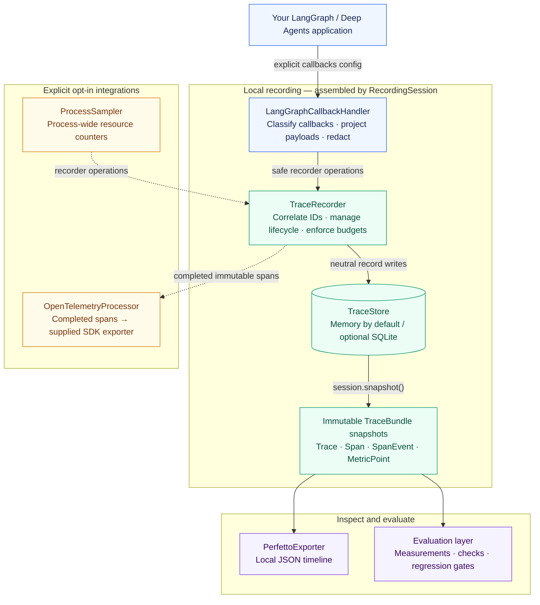

# Architecture

Local-first execution tracing for modern LangGraph and Deep Agents. The library
turns runtime callbacks into bounded, privacy-aware records that you can inspect
offline: which nodes, models and tools ran, how long they took, how they nested,
and what token usage the provider reported. Perfetto is the primary viewer; no
server, model-provider credentials or monitoring backend is required for tracing.

Start with the [README quickstart](../README.md#quickstart-trace-a-langgraph-agent).
This page explains the component boundaries; [UML diagrams](uml.md) show the
classes, protocols and runtime interactions in more detail.

## Data flow

Arrows here show **runtime data flow**, not Python imports. Dashed arrows are
opt-in paths. SQLite replaces the default memory store; it is not needed to
produce a Perfetto file. The process sampler is a producer, while the OTel bridge
is a completed-span consumer. Neither is started by default.

### From callback to useful evidence

1. **Attach explicitly.** `RecordingSession` assembles a handler, recorder and
   store. Pass `session.handler` in the agent's callback config; the library does
   not patch the runtime or construct your agent.
2. **Project before recording.** The handler recognizes graph, node, model and
   tool operations. Capture/redaction policies transform framework objects and
   application payloads before they reach the recorder. Metadata-only capture is
   the default; content capture is explicit, bounded and potentially sensitive.
3. **Correlate centrally.** The recorder maps callback IDs and parent IDs to
   canonical trace/span IDs. It owns active spans, delayed-child context, token
   totals, execution lanes, admission limits and loss diagnostics. The handler
   does not maintain a parallel lifecycle registry.
4. **Persist neutral records.** Stores receive immutable records rather than
   framework objects or Perfetto dictionaries. Reads return deterministic
   `TraceBundle` snapshots. This lets the same recording feed visualization,
   durable inspection and evaluation without format-specific tracing logic.
5. **Consume independently.** `session.export(...)` passes snapshots to
   `PerfettoExporter`. Separately, configured `SpanProcessor` implementations
   receive completed spans during recording. Exporters never query stores, and
   processors do not need to read the local recording back.

### Responsibilities and extension points

| Component | Responsibility | Deliberately does not own |
| --- | --- | --- |
| `RecordingSession` | User-facing composition, shutdown, snapshot and Perfetto export | Agent construction or execution |
| `LangGraphCallbackHandler` | Framework callback translation and safe payload projection | Stores, export formats or active-run state |
| `TraceRecorder` | Correlation, clocks/IDs, span lifecycle, budgets and destination coordination | Framework callbacks, SQLite or Perfetto behavior |
| `TraceStore` protocol | Atomic synchronous writes and immutable queries | Capture policy, recorder budgets or presentation |
| `SpanProcessor` protocol | Completed-span consumption, flush and shutdown | Callback correlation or local persistence |
| `PerfettoExporter` | Neutral snapshots to overlap-safe timeline JSON | Store queries or framework integration |
| `EvalRunner` | Isolated case trials, trace-derived metrics and assessments | A second tracing implementation |

For a custom persistence backend, implement the structural `TraceStore` protocol
and pass an empty, dedicated instance as `store=`. Buffered persistence can also
implement `FlushableTraceStore`. A completed-span destination implements
`SpanProcessor` and is supplied through `processors=`. These are separate
extension points: a store supports later queries; a processor consumes span
completion notifications. See the [class diagrams](uml.md#recording-and-extension-protocols)
and the directory-level contracts below before implementing either.

## Dependency direction

- Neutral models import no adapter, store implementation or exporter.
- Stores depend only on neutral models and store-level protocols.
- Exporters depend only on neutral models, exporter protocols and optional SDKs.
- Framework adapters depend on recorder-facing interfaces, never concrete stores or
  exporters.
- The recorder coordinates stores and processors but contains no Perfetto, SQLite,
  OTLP or demo-specific behavior.
- Evaluation models and evaluators consume neutral records and a recording session;
  they import no store implementation or exporter. Execution adapters may attach
  framework callbacks but do not own tracing.
- Optional dependencies are imported only by their explicit modules, never by the
  core package at import time.

Evaluation runs reuse the same recorder and neutral records. They emit portable
case/trial/run artifacts and trace references, not a second timeline.

## Session lifecycle and failure isolation

Use one session per bounded recording window and finish consuming any streams
before closing it. A session can contain multiple invocations; concurrent roots
retain separate trace IDs. On orderly close, remaining active spans become
abandoned, destinations are flushed/shut down, and the session retains immutable
snapshots so `snapshot()` and `export()` still work afterward.

The session closes its default memory store, but a caller-supplied store remains
the caller's responsibility. A supplied store must be empty and dedicated to that
recording. The lower-level `TraceRecorder` instead owns its supplied store by
default; use `owns_store=False` when managing that resource yourself.

Best-effort recording is the default: a failing store does not erase accepted
in-memory correlation or block independent processors. This does **not** promise
durability or exactly-once delivery. Inspect `session.diagnostics` for loss or
incompleteness. Strict mode surfaces instrumentation failures for testing; error
handling must still preserve the agent application's original exception.
Processor callbacks run outside recorder state locks and must not synchronously
flush or close their own recorder. Timeouts are cooperative, not hard cancellation.

## Evaluations build on tracing

`EvalRunner` creates a fresh session per case trial. `LangGraphEvalAdapter`
attaches that session's callback to each turn and normalizes the agent result.
The runner measures the resulting neutral traces and supplies `EvalContext` to
turn checks and, after the conversation, case checks. Checks return assessments;
execution errors remain distinct from failed assessments.

An `EvalRun` retains turn/trial results, metrics and trace IDs, not embedded trace
payloads. Provider usage that is unavailable is marked missing rather than zero.
Evaluation outputs are a separate, bounded data path: metadata-only tracing does
not make agent answers stored in evaluation artifacts non-sensitive. Aggregation
and comparison then apply explicit quality and performance gates. See the
[evaluation UML](uml.md#evaluation-classes) and [artifact/CLI guide](evals.md).

## Boundaries

- Spans express containment. Causal links require explicit evidence and are never
  inferred from names, timing or containment.
- Metadata-only capture is the default. Bounded or full payload capture is explicit,
  redacted and still subject to finite recording budgets.
- A recording belongs to one process and monotonic clock domain. Cross-process
  monotonic alignment and full distributed context propagation are not provided.
- Callback durations measure elapsed wall time, including waits and child work,
  not CPU time. Overlapping durations must not be summed as CPU time or presented
  as a proven critical path.
- Process resource counters are process-wide, not per-agent attribution.
- Automatic profiler timeline correlation is an evidenced no-go in
  [ADR-001](adr/001-profiler-correlation.md). The OTel bridge is export-only per
  [ADR-002](adr/002-otel-export-only.md).

Directory-level contracts are in
`src/langgraph_instrumentation/adapters/AGENT.md`,
`src/langgraph_instrumentation/stores/AGENT.md`,
`src/langgraph_instrumentation/exporters/AGENT.md` and
`src/langgraph_instrumentation/evals/AGENT.md`.
