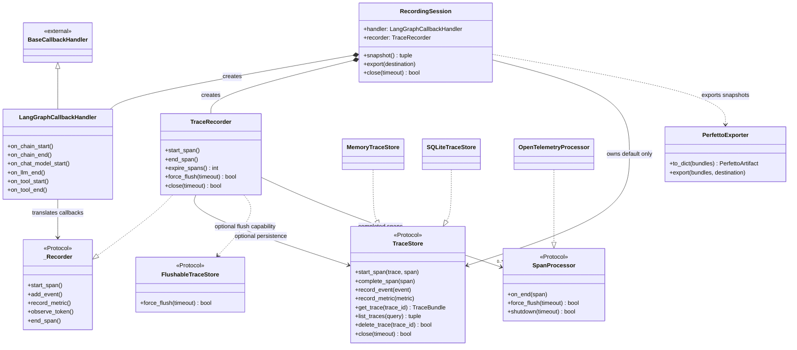
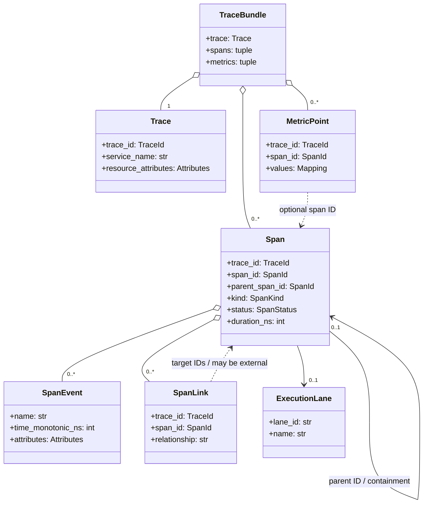
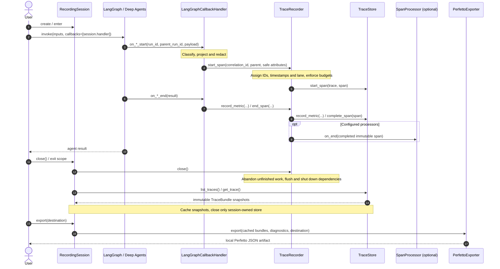
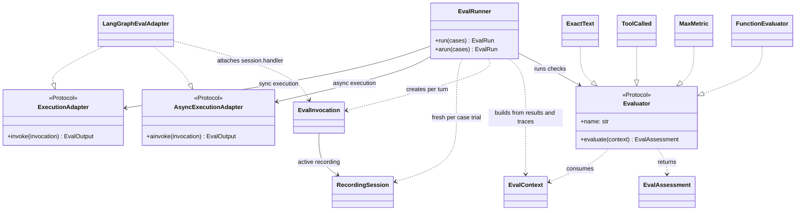
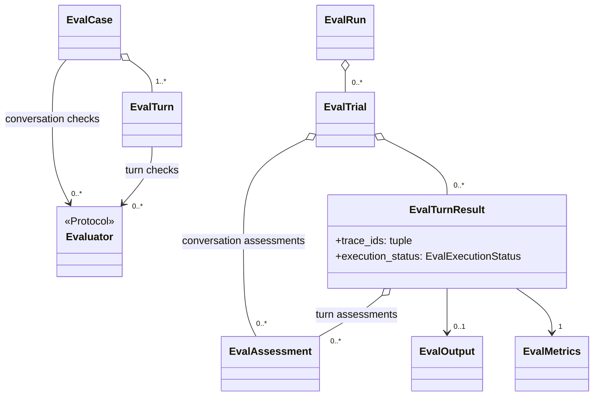

# Classes and runtime interactions

Most applications need only `RecordingSession`: attach its callback, run the agent,
and export a trace. Understanding the classes underneath helps when you need to
change persistence, add an export destination, or evaluate agent behavior.

Start with [how data moves through the library](architecture.md#data-flow), then
follow the sections below from recording to evaluation. For a working integration,
use the [quickstart](../README.md#quickstart-trace-a-langgraph-agent).

**Reading the relationships:** arrows connect collaborators; diamonds group owned
components or related records. A dashed arrow with a hollow triangle means that a
class provides the methods required by a protocol. In Python, implementing those
methods is enough; inheriting from the protocol is not required.

## Recording and extension protocols

The session connects three different jobs: translating callbacks, managing span
lifecycles, and delivering records. Keeping these jobs separate lets you change
storage or add a destination without changing the agent integration.

`LangGraphCallbackHandler` uses LangChain's `BaseCallbackHandler` hooks for both
synchronous and asynchronous execution. It translates framework callbacks into
recorder operations; `_Recorder` is the private contract for those operations,
not an interface applications need to import.

`TraceStore` writes are synchronous and atomic, with idempotent exact span
start/completion replays. Event/metric appends must not be automatically retried
after an uncertain acknowledgement. `FlushableTraceStore` is an independent,
optional capability, not a base class that every store must implement.

`PerfettoExporter` is intentionally **not** a `SpanProcessor`: it transforms a
snapshot on demand. `OpenTelemetryProcessor` implements `SpanProcessor` and
bridges completed spans to an explicitly supplied SDK exporter. It is imported
from its optional module and does not install a global provider or propagator.

Choose [SQLite recording](../README.md#durable-local-recording) when traces must
survive a process exit, or the [OTel bridge](../README.md#optional-opentelemetry-export-only-bridge)
when completed spans should also go to an existing telemetry destination. For a
custom implementation, follow the [extension contracts](architecture.md#dependency-direction).

## Payload projection and privacy

Agent inputs, outputs and tool arguments can contain secrets or large objects.
The callback handler therefore transforms them before recording. Capture policy
decides how much to retain; redaction policy removes matching fields. Usage
extraction separately preserves reported token counts without requiring body capture.

Metadata-only capture describes payload types and sizes rather than retaining
their contents. When you opt into content capture, `Sanitizer` limits traversal
and applies redaction as it goes, rather than first copying an unbounded object
graph. Field redaction cannot detect every secret in free text; review the
[artifact-sharing guidance](../SECURITY.md#protecting-recordings) before sharing a trace.

These policies precede the recorder/store trust boundary. Direct low-level
recorder and store callers must supply trusted JSON-compatible attributes and
apply their own capture policy; a store does not inherit recorder admission
budgets. See [safety limits](../README.md#safety-and-recording-limits).

## Neutral trace model

The library keeps execution evidence independent of the agent framework and the
viewer. A `TraceBundle` is a snapshot of one trace, its operations and its metrics.
Use these records to inspect a recording programmatically or build a consumer
without parsing Perfetto output.

Snapshots are immutable: completing a span does not change a snapshot you already
hold. Some values are naturally absent: a root has no parent ID, an active span
has no final duration, and a trace-scoped metric has no span ID.

`Trace` contains recording identity and resource metadata; `Span` describes one
operation. Unix timestamps support external representation, while monotonic
timestamps determine local elapsed duration. `ExecutionLane` is a logical
visualization lane, not necessarily an OS thread. Events belong to spans, and
metrics can be trace- or span-scoped.

Parent IDs express **containment**. `SpanLink` represents a separate, explicitly
evidenced relationship and can reference an endpoint outside the bundle. Neither
nesting nor timing proves a graph transition, data dependency or critical path.
See [interpreting the timeline](../README.md#view-locally) for how these records
appear in Perfetto, and [the model definitions](../src/langchain_ollie/models.py)
for their complete fields.

## Recording interaction

Recording follows the application's lifetime: open a session before invoking the
agent, consume the result or stream, then close and export. Following one operation
through that sequence explains why export can happen after the session closes.
Nested and concurrent operations use the same path with separate IDs.

Close is idempotent; snapshots/export remain available after a successful close.
In best-effort mode, store failure can leave a partial local recording while
processors still receive accepted completed spans. Store and processor delivery
are independent, so successful delivery to one does not guarantee the other.
Check session diagnostics for loss and see
[lifecycle and failure isolation](architecture.md#session-lifecycle-and-failure-isolation).

## Evaluation classes

Tracing explains what happened; evaluation asks whether it was acceptable.
`EvalRunner` combines an execution adapter with checks over answers and trace
evidence. This lets you test both correctness and execution costs, such as whether
a required tool ran or a model-call budget was exceeded.

The two adapter protocols separate sync and async capabilities. The built-in
`LangGraphEvalAdapter` implements both, provided the wrapped application supports
the requested invocation method. A custom execution adapter uses the supplied
session rather than creating a second recorder.

For each case trial, the runner invokes turns in sequence with isolated history
or a trial-specific checkpoint thread ID. After each turn it measures new trace
bundles and evaluates turn checks. Conversation checks run after completed
execution. `EvalContext` supplies output, metrics, traces and prior turn results;
an `Evaluator` returns an `EvalAssessment`. The diagram shows representative
checks; text, state, metric and optional judge checks share the same protocol.

### Definitions and results

Keep the intended behavior separate from the observed behavior. Cases and turns
define the test; runs, trials and turn results record what happened. A trial is
one execution of a case, so repeated trials reveal inconsistent behavior without
changing the case definition.

Definitions (`EvalCase`, `EvalTurn`), observations (`EvalOutput`, turn/trial
results), measurements (`EvalMetrics`) and judgments (`EvalAssessment`) remain
separate. Execution failure is not an ordinary failed check. Results retain trace
IDs, not a duplicate timeline; trace-derived metrics record provenance and
completeness. Aggregation and comparison operate on those results afterward.

Try [your first evaluation](evals.md#run-your-first-evaluation), then use the
[artifact and CLI guide](evals.md#save-and-reopen-results) or the
[reviewed dataset-improvement workflow](agent-eval-workflow.md).
