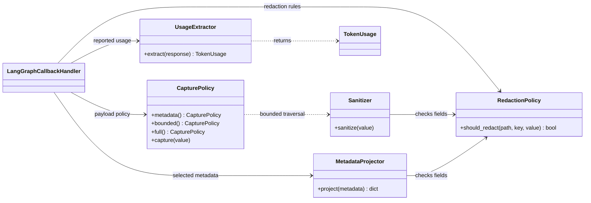
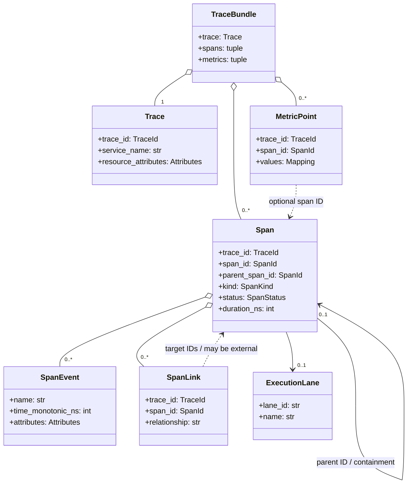
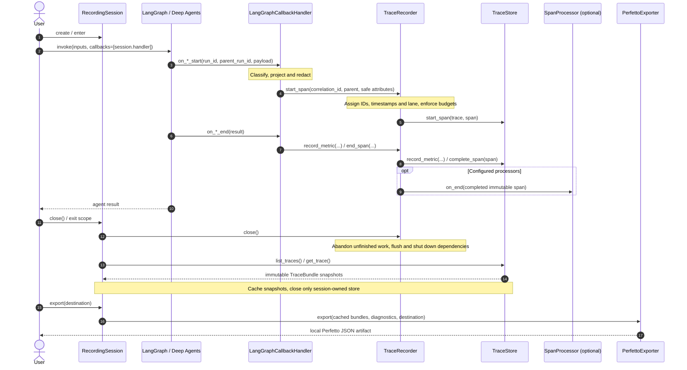
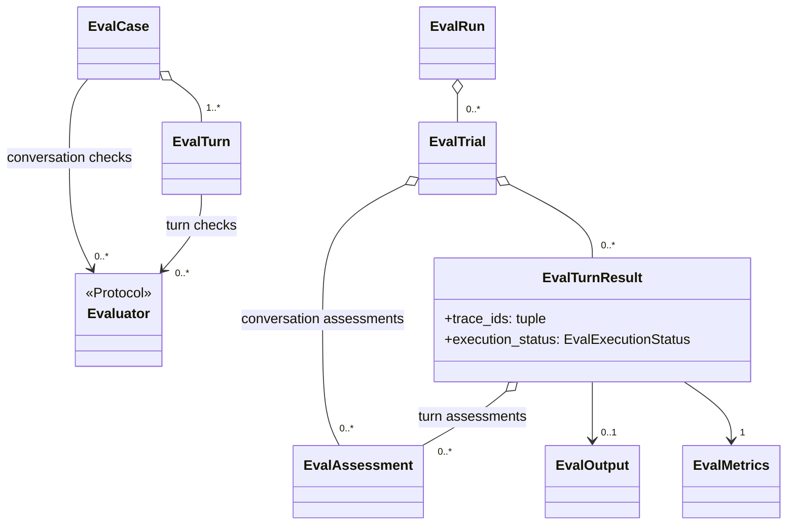

# Classes and runtime interactions

These UML views complement the [architecture overview](architecture.md). They use
Mermaid, which GitHub renders directly; other Markdown viewers need Mermaid
support to display the fenced blocks. Diagrams show selected methods and fields,
not exhaustive API signatures. Names match the implementation.

**Notation:** solid arrows show associations, hollow diamonds group records,
filled diamonds indicate owned components, dashed arrows show use dependencies,
and dashed hollow-triangle arrows mean structural protocol conformance. Python
`Protocol` implementations need not inherit from the protocol. `_Recorder` is a
private adapter-local contract, not an additional public API.

## Recording and extension protocols

`BaseCallbackHandler` comes from `langchain_core`. The same ordinary `on_*` hooks
serve synchronous and asynchronous agent execution; there is no separate async
tracing engine. The adapter depends only on `_Recorder`, so translation can be
tested with a fake recorder without involving a store or exporter.

`TraceStore` writes are synchronous and atomic, with idempotent exact span
start/completion replays. Event/metric appends must not be automatically retried
after an uncertain acknowledgement. `FlushableTraceStore` is an independent,
optional capability, not a base class that every store must implement.

`PerfettoExporter` is intentionally **not** a `SpanProcessor`: it transforms a
snapshot on demand. `OpenTelemetryProcessor` implements `SpanProcessor` and
bridges completed spans to an explicitly supplied SDK exporter. It is imported
from its optional module and does not install a global provider or propagator.

Source: [session](../src/langgraph_instrumentation/session.py),
[callback adapter](../src/langgraph_instrumentation/adapters/langgraph.py),
[recorder](../src/langgraph_instrumentation/recorder.py),
[store protocols](../src/langgraph_instrumentation/stores/base.py),
[exporters](../src/langgraph_instrumentation/exporters/).

## Payload projection and privacy

Framework normalization lives in
[adapters/projection.py](../src/langgraph_instrumentation/adapters/projection.py);
general capture, redaction, metadata and usage policies live in
[policies.py](../src/langgraph_instrumentation/policies.py). Normalization happens
within bounded projection rather than first copying an unbounded object graph.
Metadata-only capture describes payload types and sizes without traversing
builtin container contents. Content capture remains subject to safety budgets,
and field redaction is not a universal secret detector for free text.

These policies precede the recorder/store trust boundary. Direct low-level
recorder and store callers must supply trusted JSON-compatible attributes and
apply their own capture policy; a store does not inherit recorder admission
budgets. See [safety limits](../README.md#safety-and-recording-limits).

## Neutral trace model

All these [records](../src/langgraph_instrumentation/models.py) are frozen
dataclasses with immutable nested attributes. Completion creates a replacement
`Span`; it does not mutate a previously returned snapshot. Optional fields such
as a root's parent ID, an active span's duration and a trace-scoped metric's span
ID can be absent (types in the diagram are abbreviated).

`Trace` contains recording identity and resource metadata; `Span` describes one
operation. Unix timestamps support external representation, while monotonic
timestamps determine local elapsed duration. `ExecutionLane` is a logical
visualization lane, not necessarily an OS thread. Events belong to spans, and
metrics can be trace- or span-scoped.

Parent IDs express **containment**. `SpanLink` represents a separate, explicitly
evidenced relationship and can reference an endpoint outside the bundle. Neither
nesting nor timing proves a graph transition, data dependency or critical path.

## Recording interaction

The successful path below follows a single operation; real agents interleave
callbacks from many nested or concurrent operations. Projection and neutral-record
creation are abbreviated. Store writes and processor callbacks are separate
destinations, not one atomic transaction.

Close is idempotent; snapshots/export remain available after a successful close.
In best-effort mode, store failure can leave a partial local recording while
processors still receive accepted completed spans. Diagnostics disclose that loss;
the diagram does not imply guaranteed delivery. See
[lifecycle and failure isolation](architecture.md#session-lifecycle-and-failure-isolation).

## Evaluation classes

The two adapter protocols separate sync and async capabilities. The built-in
`LangGraphEvalAdapter` implements both, provided the wrapped application supports
the requested invocation method. A custom execution adapter uses the supplied
session rather than creating a second recorder.

For each case trial, the runner invokes turns in sequence with isolated history
or a trial-specific checkpoint thread ID. After each turn it measures new trace
bundles and evaluates turn checks. Conversation checks run after completed
execution. `EvalContext` supplies output, metrics, traces and prior turn results;
an `Evaluator` returns an `EvalAssessment`. The diagram shows representative
checks; text, state, metric and optional judge checks share the same protocol.

### Definitions and results

Definitions (`EvalCase`, `EvalTurn`), observations (`EvalOutput`, turn/trial
results), measurements (`EvalMetrics`) and judgments (`EvalAssessment`) remain
separate. Execution failure is not an ordinary failed check. Results retain trace
IDs, not a duplicate timeline; trace-derived metrics record provenance and
completeness. Aggregation and comparison operate on those results afterward.

Source: [runner](../src/langgraph_instrumentation/evals/runner.py),
[execution protocols/adapters](../src/langgraph_instrumentation/evals/adapters.py),
[evaluators](../src/langgraph_instrumentation/evals/evaluators.py),
[evaluation models](../src/langgraph_instrumentation/evals/models.py).
Continue with the [artifact and CLI guide](evals.md) or the
[reviewed dataset-improvement workflow](agent-eval-workflow.md).
